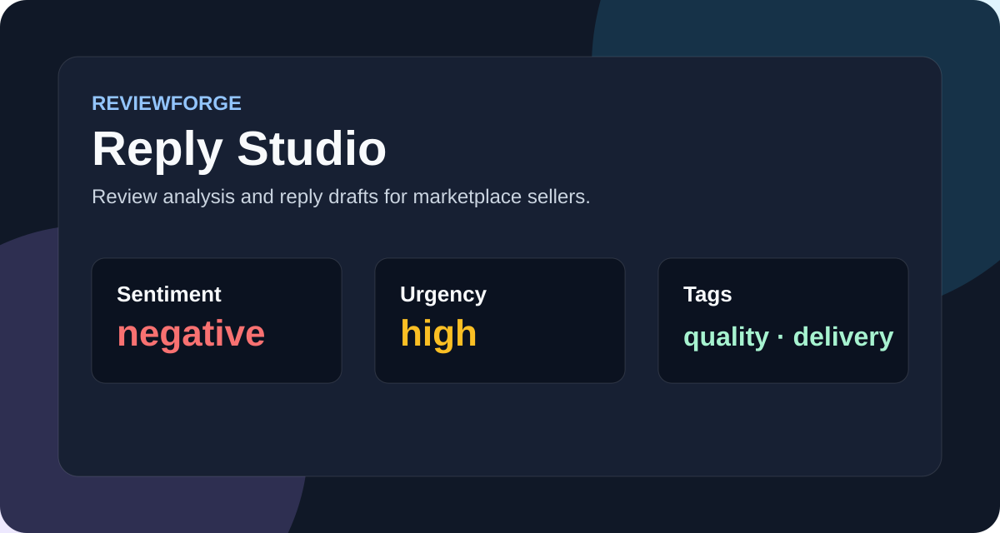

# ReviewForge Reply Studio



Python tool for analyzing marketplace reviews and generating seller-ready replies. It is intentionally dependency-light: the demo works with standard Python and is easy to run on any laptop or VPS.

## What it does

- Classifies reviews by sentiment, urgency and complaint tags.
- Detects delivery, quality, size, packaging and support issues.
- Generates polite replies in different tones.
- Produces a batch markdown report for a seller or content manager.
- Includes unit tests for the scoring logic.

## Run

Install the local package first:

```bash
python -m pip install -e .
```

```bash
python -m reviewforge.cli examples/reviews.json --brand "SmartSeller"
```

Run tests:

```bash
python -m unittest discover -s tests
```

## Example Output

```text
Review #2
Sentiment: negative | Urgency: high | Tags: quality, delivery
Reply: Спасибо за обратную связь...
```

## Why this project is useful

Marketplace sellers often lose rating because they answer reviews randomly or too late. ReviewForge turns raw feedback into a structured response workflow.

## Structure

```text
src/reviewforge/analyzer.py   sentiment and issue detection
src/reviewforge/generator.py  reply templates and batch report
src/reviewforge/cli.py        command-line interface
tests/                        unit tests
```
